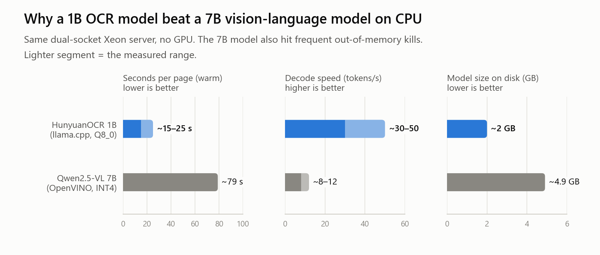
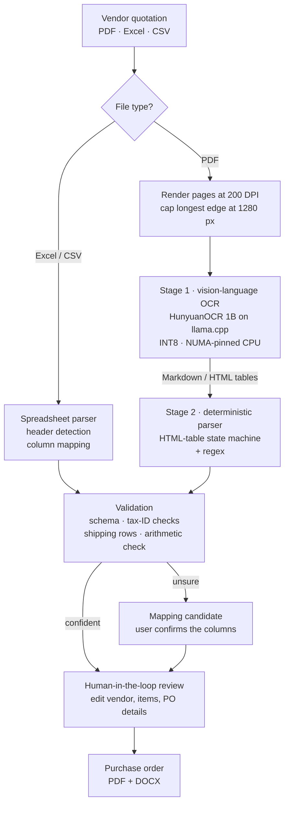
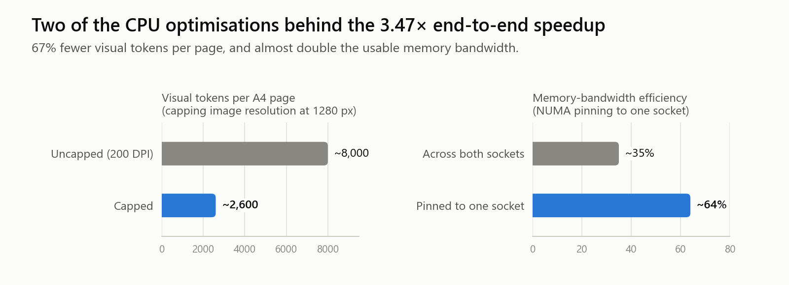

# QuoteVision: Vision-LLM Quotation Parser

Turns vendor quotations (scanned PDFs, Excel and CSV files) into validated purchase-order data, using self-hosted vision-language models that run on a CPU-only server.

> **Note:** The source code is private. This repository documents the architecture, design decisions and measured results. I'm happy to walk through the implementation in an interview.

<picture>
  <source media="(prefers-color-scheme: dark)" srcset="assets/model-comparison-dark.png">
  
</picture>

---

## Overview

A procurement team receives quotations from many vendors, and each one arrives in a different layout. Before this project, staff re-typed every line item into the purchase-order system by hand: a 4-page, 36-item quotation took more than 20 minutes of error-prone data entry.

Rule-based PDF parsing couldn't keep up. GST quotations have no standard format, and across a test set of seven real vendor documents, the item tables ranged from a single concatenated text blob to an 18-column borderless grid. A spreadsheet even stated a grand total that was mathematically impossible.

QuoteVision reads each page the way a person does. A small vision-language OCR model turns the page image into Markdown with its tables intact, deterministic code turns that into structured data, and validation rules check the numbers before a person reviews and approves the purchase order. Everything runs on a dual-socket CPU server with no GPU.

## Key Features

- **Any quotation format:** scanned or digital PDFs through the vision pipeline, and Excel or CSV files through a deterministic parser with header detection and column mapping.
- **Two-stage extraction:** vision-language OCR produces Markdown/HTML tables, and a state-machine parser maps them to a strict schema, so the model is never trusted to invent structure.
- **Validation before anything is saved:** vendor and buyer tax IDs are told apart, shipping and summary rows are separated from items, and line totals are cross-checked arithmetically. A computed total overrides one that doesn't add up.
- **Graceful degradation:** if the model output is malformed or the model is unavailable, the system returns a column-mapping suggestion for the user to confirm instead of failing.
- **Human in the loop:** extracted vendor details and items open in an editable review screen, then flow straight into purchase-order generation (PDF and DOCX).
- **CPU-only inference:** quantised models, NUMA pinning and image-token budgeting make billion-parameter vision models practical without a GPU.

## Architecture

## How It Works

1. A user uploads a vendor quotation. Spreadsheets go to the deterministic parser; PDFs are rendered to images at 200 DPI.
2. Each page image is downscaled so its longest edge is 1280 px, which keeps the number of visual tokens (and the cost of attention) under control.
3. A 1B-parameter vision-language OCR model, served by llama.cpp on a NUMA-pinned CPU socket, converts the page into Markdown with HTML tables.
4. A deterministic parser walks those tables and maps them to a strict schema: vendor, line items, taxes, shipping and totals.
5. Validation separates vendor and buyer tax IDs, splits out shipping rows and checks the arithmetic. If it isn't confident, it returns a column-mapping suggestion instead.
6. The user reviews and edits the result, and the existing purchase-order service generates the PDF and DOCX.

## Results

<picture>
  <source media="(prefers-color-scheme: dark)" srcset="assets/optimisations-dark.png">
  
</picture>

| Metric | Result |
|---|---|
| Real vendor documents handled correctly | 7 of 7, including 35 line items from a 4-page PDF |
| End-to-end speedup over the first implementation | 3.47× |
| Visual tokens per page | ~8,000 → ~2,600 (67% fewer) with resolution capping |
| Time per page, warm (1B OCR model vs 7B VLM) | ~15–25 s vs ~79 s |
| Spreadsheet parsing | Under 1 second, no ML needed |
| Automated tests | 12 of 12 passing, including an end-to-end test with real model inference |

All figures were measured on the deployment server (dual-socket Intel Xeon, no GPU).

## Tech Stack

| Category | Tools |
|---|---|
| OCR | Self-hosted vision-language models (HunyuanOCR 1B, Qwen2.5-VL 7B), Google Cloud OCR, pdf2image |
| Inference | llama.cpp (GGUF Q8_0, AVX-512 VNNI), Intel OpenVINO GenAI with NNCF INT4 weight compression |
| CPU optimisation | NUMA pinning (`numactl`), INT8 KV cache, physical-core thread pinning, image-token budgeting |
| Parsing and validation | Python state machine for HTML tables, regex, Pydantic schemas |
| Backend | FastAPI microservice, job API |
| Platform | FastAPI, React + TypeScript, PostgreSQL, SQLModel, Alembic |
| Documents | HTML to PDF (wkhtmltopdf), PDF to DOCX |
| Deployment | Docker Compose, systemd, Nginx |
| Testing | pytest, with a mocked model for fast tests and a real-model integration test |

## Engineering Decisions

- **Read the page as an image:** three rule-based attempts with `pdfplumber` (lattice tables, text strategy and word-coordinate clustering) each failed on at least two of the seven real documents. Treating the page visually removed the dependency on how each vendor's software happened to build its PDF.
- **A 1B OCR model plus deterministic parsing, instead of a 7B model emitting JSON:** the 7B model saturated memory bandwidth and was repeatedly killed for running out of memory on the CPU server. The 1B model is about 7× smaller, faster per page and more accurate on these invoices, and leaving the structure to deterministic code makes the output predictable.
- **Pin to one CPU socket:** on a dual-socket server, threads that fetch model weights across sockets waste bandwidth. Pinning the process and its memory to one NUMA node raised measured bandwidth efficiency from ~35% to ~64%.
- **Cap the image resolution:** attention cost grows quadratically with the number of visual tokens. Capping the longest edge at 1280 px cut tokens per page by 67% with no meaningful loss of OCR quality on invoice-sized text.
- **One thread per physical core:** inference uses the 16 physical cores of one socket, because hyper-threaded siblings would compete for the same AVX-512 units.
- **Check the arithmetic:** vendor documents can be wrong. Line totals are recomputed from quantity and rate, and a computed total replaces a stated one that doesn't add up, before any figure reaches a purchase order.

## The Platform Around It

QuoteVision plugs into a procurement platform that searches live prices across six electronics marketplaces, keeps a shortlist with Excel export, and generates purchase orders and quotations as matching PDF and DOCX files. The parser runs as its own FastAPI microservice; the platform forwards uploads to it and feeds the reviewed result into its existing purchase-order endpoint.

## My Role

The application was planned with the team. I built the AI document-intelligence layer end to end, working with both Google Cloud's OCR service and open-source OCR models and libraries: the two-stage vision pipeline, its CPU optimisation (quantisation, NUMA pinning and image-token budgeting), the deterministic parser and validation rules, and the test suite. I also developed the procurement platform that it plugs into.

## Contact

**Zayed Makandar** | [zayedmakandar03@gmail.com](mailto:zayedmakandar03@gmail.com) | [LinkedIn](https://www.linkedin.com/in/zayed-makandar-642536422/) | [Portfolio](https://zayedmakandar.com)
